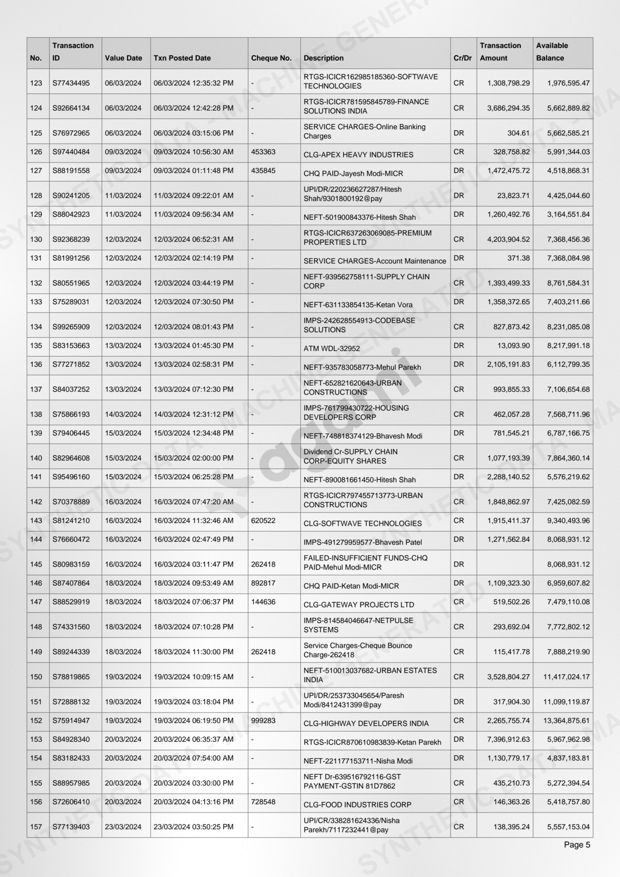
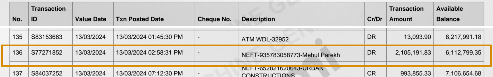
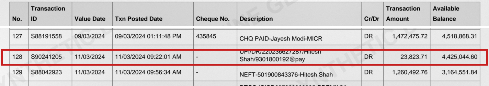

<p align="center">
  
</p>

<h1 align="center">Probity</h1>

<p align="center"><b>A low-cost vision model reads the scanned statement. A state machine with rules decides what is confirmed, what has to be read again, and what does not add up.</b></p>

<p align="center">
  <a href="LICENSE"></a>
  
  
  
  
  
</p>

## Summary

Small vision models can transcribe a scanned bank statement for a few cents. They cannot
be relied on to say whether the transcription is right: they put amounts in the wrong
column, drop digits, and, asked to check their own work, declare altered statements
consistent.

Probity keeps the model for reading and removes it from every decision. One model
transcribes each page. Rules implemented as code check the transcription with exact
integer arithmetic and locate any failure to a row. Where a rule fails, a different
model transcribes that page again without seeing the first transcription, and code
compares the two and re-runs the rule. If the two models agree and the rule still
fails, a third, higher-resolution reading is taken before the document is held
responsible. Each document ends in one of three conclusions, and every value that was
changed is recorded with both readings.

The claim this repository tests is simple: **use models to read and code to decide.**
Where an answer can be checked by computation, a model's judgment of its own work adds
risk, not assurance, and a fixed state machine with rules does better than the same
models asked to verify themselves.

It was evaluated once, with the code frozen, on documents it had never seen: 120
scanned bank statements and 100 real scanned receipts. Of 52 statements with an
alteration that arithmetic can detect, the two models working alone confirmed 50 and 22
of 26 and located none. The same two models inside Probity confirmed 1 and located the
altered row exactly in 42, at about the same cost. The price is coverage: 8 of 40 clean
statements were handed to a person instead of confirmed. The statements are synthetic
and the alterations are simple. [Limits](#limits) says what the evaluation does and does
not support.

## Result

The protocol, the test split and the outcomes that would count against the method were
committed before any test document was built. The code was frozen, and each condition
was run once.

<p align="center">
  
</p>

**120 scanned six-page statements, image only.** 40 tie. 52 carry one alteration that
arithmetic can detect: an amount or a balance changed, a row removed, or an amount moved
to the other column. The other 28 carry alterations that leave the arithmetic exact, and
are reported under [Limits](#limits).

| 120 statements never seen in development | **Probity** | Gemini alone | Gemini with a Python interpreter | OCR and the same rules | Qwen alone (60) |
|---|---:|---:|---:|---:|---:|
| clean statements confirmed | **32 of 40** | 36 of 40 | 17 of 40 | 9 of 40 | 20 of 20 |
| altered statements confirmed (should be 0) | **1 of 52** | 50 of 52 | 2 of 52 | 0 of 52 | 22 of 26 |
| altered row named, and no other | **42 of 52** | 0 of 52 | 9 of 52 | 15 of 52 | 0 of 26 |
| clean statements reported as inconsistent | **0 of 40** | 4 of 40 | 20 of 40 | 11 of 40 | 0 of 20 |
| every amount, balance and row date correct | **84 of 120** | 22 of 120 | 26 of 120 | 31 of 120 | 39 of 60 |
| no usable answer | 0 | 0 | 13 | 0 | 3 |
| cost per statement | $0.045 | about $0.047 | about $0.064 | none | $0.041 |

**100 real scanned receipts,** 50 as scanned and 50 with one amount repainted. The
receipt is a second document type, added as [one YAML file](examples/specs/receipt_cord.yaml).

| 100 receipts | **Probity** | Gemini alone | Qwen alone | Gemini with a Python interpreter | OCR and the same rules |
|---|---:|---:|---:|---:|---:|
| clean receipts confirmed | **50 of 50** | 50 of 50 | 48 of 50 | 47 of 50 | 8 of 50 |
| altered receipts confirmed (should be 0) | **0 of 50** | 24 of 50 | 34 of 50 | 13 of 50 | 0 of 50 |
| altered receipts reported | **37 of 50** | 26 of 50 | 14 of 50 | 32 of 50 | 28 of 50 |
| clean receipts reported as inconsistent | 0 of 50 | 0 of 50 | 1 of 50 | 0 of 50 | 23 of 50 |

**The columns.** *Gemini alone* and *Qwen alone* are `google/gemini-3.1-flash-lite` and
`qwen/qwen3.5-flash-02-23` each doing the whole job: transcribe the document, then,
with every page image and its own transcription in front of it, correct what it
misread, check every row and the total exactly, say whether the document is consistent,
name the rows that do not add up, and finally re-examine its own answer. *With a Python
interpreter*, Gemini may also run code on its transcription before answering. *OCR and
the same rules* uses a conventional OCR engine and no language model. *Probity* uses
Gemini as the first reader and Qwen as the second, with code doing the checking and
deciding. Qwen alone ran on a seeded half of the statements.

**What the tables show.**

- *The models alone confirm almost anything.* Confirming a clean statement is the easy
  direction: a system that says "consistent" to everything scores 40 of 40. The same
  habit confirms 50 of 52 altered statements. Two rewordings of the instructions gave
  13 of 13 and 12 of 13.
- *Letting the model compute is not the answer.* With a Python interpreter the model
  sees that a balance fails, but it is computing on its own uncorrected transcription
  and cannot tell a misread from an alteration. It reported half of the clean
  statements as inconsistent.
- *OCR with the same rules is not the answer either.* It confirms 9 of 40 clean
  statements, and none on the two harder scan tiers.
- *Probity never reported a clean document.* All 42 statements it reported as
  inconsistent had been altered, and each report names exactly the altered row.

**The altered statement Probity confirmed.** A debit had been moved to the credit
column. The first reader transcribed it as a debit, where it had been before the
alteration. That reading is consistent, so no rule failed and no second look was taken.
The protocol said in advance that this would count against the method, and it does: a
misreading that happens to agree with the arithmetic is invisible to it.

**The clean statements Probity did not confirm.** Eight of 40 ended `UNRESOLVED`,
mostly because a rule still failed on a few rows and the two readings did not settle
it. Each goes to a person with those rows and both readings.

**The assumption underneath.** The method treats agreement between two different models
as evidence of what is printed. Measured cell by cell on 58 statements, the two models
were wrong in the same way on 2 of 28,113 amounts.

The full record, with intervals, results by scan quality, the contribution of the second
model, variation between runs and every failure, is in
[docs/RESULTS.md](docs/RESULTS.md).

## Contents

- [One document, start to finish](#one-document-start-to-finish)
- [How it works](#how-it-works)
- [What a conclusion means](#what-a-conclusion-means)
- [Does it matter who decides?](#does-it-matter-who-decides)
- [Quickstart](#quickstart)
- [What you get back](#what-you-get-back)
- [Rules and document types](#rules-and-document-types)
- [Where this is meant to go](#where-this-is-meant-to-go)
- [Limits](#limits)
- [Repository map](#repository-map)
- [Reproducing](#reproducing)
- [Citing](#citing)
- [Licence](#licence)

## One document, start to finish

Everything in this section is in [`examples/scanned/`](examples/scanned/), produced by
the command shown and not edited.

### Input

[`examples/scanned/altered_statement.pdf`](examples/scanned/altered_statement.pdf): six
pages, 167 transactions, greyscale, no text layer. One debit on page 5 was changed from
`93,823.71` to `23,823.71` before the pages were flattened to images. Nothing on the
page says so.

<p align="center">
  
</p>

### Command

```bash
export OPENROUTER_API_KEY=...
probity verify examples/scanned/altered_statement.pdf \
    --spec examples/specs/agami_type2.yaml \
    --model google/gemini-3.1-flash-lite \
    --second-model qwen/qwen3.5-flash-02-23 \
    --report report.md --certificate certificate.json --explain
```

### What the machine did

**1. The first reading failed nine checks.** Eight row-balance checks and the closing
total. At this point a misread and an alteration look the same:

```
[ROW_BAL] row 69:  8,070,969.48 - 2,870,115.04 = 5,200,854.44, balance transcribed as 5,200,854.40
[ROW_BAL] row 70:  off by 0.04        (the row after a misread balance fails too)
[ROW_BAL] row 73:  off by 14,133,694.84
[ROW_BAL] row 77:  off by 11,307,496.72
[ROW_BAL] row 78:  off by 11,275,596.60
[ROW_BAL] row 127: off by 70,000.00
[ROW_BAL] row 135: off by 4,210,383.66
[ROW_BAL] row 148: off by 230,835.56
[GLOBAL_BAL] opening balance + movements does not equal the closing balance
```

**2. The second reader was asked for pages 3 and 5,** the two pages with failures. It
received the page image and the transcription instruction, and nothing else.

**3. Five rows were corrected from the second reading.** On rows 69, 73, 77, 78 and
135 the second reader's transcription differed, and with it the rule passed and no
other check failed. Row 135, on the page:

<p align="center">
  
</p>

| row 135 (printed as No. 136) | debit | credit | row-balance rule |
|---|---|---|---|
| first reader | (blank) | 2,105,191.83 | fails |
| second reader | 2,105,191.83 | (blank) | passes → row corrected |

**4. On two rows the models agreed with each other, and the rule still failed.** Rows
127 and 148. Agreement between two models is strong evidence, but they were reading the
same image and can share a mistake, so before the document is held responsible the
first reader transcribes the page once more at a higher resolution.

| | first reader | second reader | third reading (higher resolution) | outcome |
|---|---|---|---|---|
| row 148 | debit 115,417.78 | debit 115,417.78 | **credit** 115,417.78 | with the third reading the row ties: both models had misread the column. **Corrected** |
| row 127 | debit 23,823.71, balance 4,425,044.60 | the same | the same | three readings agree and the row does not tie. **The document is inconsistent here** |

**5. Row 127 is the alteration.**

<p align="center">
  
</p>

```
Row 127 (printed as No. 128), page 5

previous balance         4,518,868.31
movement                   -23,823.71
should read              4,495,044.60
transcribed balance      4,425,044.60
difference                 -70,000.00
```

The 70,000.00 gap is exactly the size of the alteration: `93,823.71` had been changed to
`23,823.71`.

### Output

```
altered_statement: DOCUMENT_INCONSISTENT
  the rules fail at row:127, and two readers agree on what is printed there and on the
  balance carried into it
  6 row(s) corrected: [69, 73, 77, 78, 135, 148]
```

Of 167 rows, six were misread and corrected, one was reported, and the one reported is
the one that had been altered. Total cost $0.05.

| file | contents |
|---|---|
| [`altered_statement.report.md`](examples/scanned/outputs/altered_statement.report.md) | the report for a person: conclusion, corrections table, each reported row with the arithmetic and both readings |
| [`altered_statement.explain.txt`](examples/scanned/outputs/altered_statement.explain.txt) | every step the machine took and why |
| [`altered_statement.certificate.json`](examples/scanned/outputs/altered_statement.certificate.json) | the same as data |
| [`clean_statement.report.md`](examples/scanned/outputs/clean_statement.report.md) | a statement that ties: two misread rows corrected, then confirmed |

The reports for all 120 test statements are in
[`results/sealed/statements/probity/reports/`](results/sealed/statements/probity/reports/).

Rows are numbered from 0 in every output, so row 127 is the line the statement prints
as No. 128.

## How it works

<p align="center">
  
</p>

**This is not an agent.** No model plans, chooses a tool, or decides what happens next.
The flow is fixed: read, check, re-read where a check failed, compare, conclude. Every
step after reading is ordinary code, and every transition is taken on the result of a
rule, never on a model's opinion. A model is called for one thing only: to transcribe a
page.

**The model reads, and only reads.** It is asked for the characters on the page as
printed. It is not asked to add anything up or to say whether the document is
consistent.

**Code parses.** Amounts go from printed characters to integer cents under the locale
declared for the document type. No floating point is involved. A cell that does not
parse is marked unreadable; it is never guessed.

**Rules check, with exact equality.** The main rule is the running balance on every
row, `balance[i] = balance[i-1] + credit[i] - debit[i]`. Checking every row, and not
only the total, turns "this statement does not balance" into "row 127 is off by
70,000.00", and that location is what makes a targeted second look possible.

**A second model looks again, blind.** A failed rule, not a model, triggers the second
look. A different model transcribes the page where the rule failed. It is not shown the
first transcription, the rule, or the row in question, and it is not asked to fix
anything: a model told that a row does not balance will produce a number that does.

**Code decides between the readings, under six guards.** The second reading is used on
a row only if that row was itself failing, every rule on it then passes, and no check
fails that was not failing before. A value is taken only from a row matched to the same
printed line by date, balance and description. A row is reported as inconsistent only
when the two readers independently agree on it and on the balance carried into it. Each guard closes one specific way a wrong value could otherwise be accepted;
they are specified, with an example of each, in
[docs/METHOD.md](docs/METHOD.md).

**A third reading breaks a tie.** When the two models agree on a row and the rule still
fails, the first model transcribes the page once more at a higher resolution. If that
reading differs and satisfies the same guards, the row is corrected and recorded as
such; the two models had shared a misreading. If it agrees, or settles nothing, the row
is reported as inconsistent.

**The second reader costs nothing when the first reading passes.** It is asked only for
a page where a rule failed, or the page before it when the failing row is the first on
its page, and at most once per page. In the evaluation the second reader accounted for
11% of the cost.

**Without a second reader** the same machinery runs with the first model re-reading its
own page at a higher resolution. That corrects many misreads (8 of 13 clean statements
confirmed in the evaluation, against 9 of 13), but a model agreeing with itself confirms
nothing, so a statement that still fails ends unresolved and is never reported as
inconsistent: 0 of 17 altered statements located, against 14 of 17.

Underneath, this is a state machine with 10 states and 16 transitions held as a data
table with named guards: [docs/STATE_MACHINE.md](docs/STATE_MACHINE.md). The layering
and the design rules are in [docs/ARCHITECTURE.md](docs/ARCHITECTURE.md).

## What a conclusion means

| conclusion | it says | it does not say |
|---|---|---|
| `CONFIRMED` | the final transcription satisfies every rule | that the transcription is what is printed, or that the document is authentic |
| `DOCUMENT_INCONSISTENT` | two models transcribed the named row, and the balance carried into it, identically, those figures break a rule, and a third reading did not offer a consistent alternative | why. An alteration, a bank error and a misreading shared by every reading look the same |
| `UNRESOLVED` | the reading could not be confirmed: a rule fails and the two readings did not settle it, or a cell was unreadable, or a second reading was unavailable | anything about the document. Whatever was read, and both readings where there are two, are given to a person |

Two points deserve to be stated plainly.

**A correction is chosen by arithmetic.** A value is taken from the second reader
because the rule then passes. A wrong value almost never makes an exact integer
equation close by chance, so this is strong evidence against a misread digit or a
swapped column. It is not proof of what is printed.

**Models can be wrong together.** Two models reading the same image sometimes make the
same mistake; the worked example above contains one. The third reading exists for that
case and corrected it. It is the same model as the first reader looking at a sharper
image, not a third independent reader, so three readings can still share a misreading.
When they do and it breaks a rule, a row is reported that should not be; a shared
misreading that happens to be consistent is confirmed, which happened once in the
evaluation, with a single reader.

## Does it matter who decides?

The main comparison is between whole workflows. To isolate the deciding step, in a
separate experiment during development, 191 digital statements (97 clean, 94 altered) were read from their text layer, so that all
191 readings match the answer key exactly, and the same reading was judged three ways.

| who decides, given a perfect transcription | clean accepted | altered accepted |
|---|---:|---:|
| the rules, as code | 97 of 97 | **0 of 94** |
| `gemini-3.1-flash-lite`, shown the rules' findings | 91 of 97 | 0 of 94 |
| `gemini-3.1-flash-lite`, shown only the transcription | 88 of 97 | **84 of 94** |

With nothing to misread and one question to answer, the model accepted 84 of the 94
altered statements. Shown the rules' findings it accepted none, and rejected six clean
ones. The rules cost nothing to run. Details are in
[docs/DEVELOPMENT_SAMPLE.md](docs/DEVELOPMENT_SAMPLE.md).

### What this suggests, and where it stops

Not every problem needs a harness of agents. Here, adding more model judgment (a
self-check, a model reviewing its own answer, a Python interpreter) did not fix the
failure; removing the judgment from the models did. The same two models, at the same
cost, went from letting almost every altered statement through to letting one in 52
through.

Three conditions bound that conclusion:

- **It needs a rule that code can compute.** A bank statement has a running balance.
  A task with no computable check gives this approach nothing to stand on, and that is
  where agents or human review still earn their place.
- **It is not an argument against models.** They do the part nothing else can: reading
  a scanned page. The point is about who holds the verdict.
- **The evidence has edges.** The statements come from one synthetic corpus, the
  alterations are single and simple, and larger models were left out on purpose.

## Quickstart

```bash
git clone https://github.com/maximer-v/probity && cd probity
pip install -e ".[all]"
export OPENROUTER_API_KEY=...        # read from the environment, never stored
```

**A scanned PDF**

```bash
probity verify scan.pdf \
    --spec examples/specs/agami_type2.yaml \
    --model google/gemini-3.1-flash-lite \
    --second-model qwen/qwen3.5-flash-02-23 \
    --report report.md --certificate certificate.json --csv rows.csv --explain
```

**A photo or an image file.** PNG, JPEG, TIFF, WebP, BMP and GIF. The type is taken
from the file's content, phone-photo rotation is applied, and a multi-page TIFF becomes
several pages. Image input is unit-tested but has not been measured on real photographs.

```bash
probity verify statement.jpg --spec ... --model ... --second-model ...
probity verify page1.jpg page2.jpg page3.jpg --spec ... --model ... --second-model ...
```

**From Python**

```python
from probity import (Document, DocumentSpec, Pipeline, default_proposers,
                     render_report, vlm_proposer)

reader = vlm_proposer("google/gemini-3.1-flash-lite", cap_usd=0.50)
second = vlm_proposer("qwen/qwen3.5-flash-02-23", tier="checker", client=reader.client)

spec = DocumentSpec.load("examples/specs/agami_type2.yaml")
result = Pipeline(spec, default_proposers(llm_small=reader, checker=second)).run(
    Document("stmt", "scan.pdf"))

result.conclusion          # "CONFIRMED" | "DOCUMENT_INCONSISTENT" | "UNRESOLVED"
result.conclusion_reason   # one sentence, naming the rows
result.corrections         # each changed value: row, field, both readings, rules, method
result.opinions            # every second look, with both readings side by side
result.statement.rows      # the final transcription
print(render_report(result.certificate.to_json()))
```

**Other commands**

```bash
probity report certificate.json     # the readable report, from a stored certificate
probity machine --format table      # the state machine
probity specs                       # the document types available
```

Exit codes of `verify`: `0` confirmed, `1` not confirmed, `2` could not be processed.

The two models must be different; the same model given twice is refused. Model replies
are cached by content in `--cache-dir`, so running the same document again costs
nothing and returns the same replies (a network connection is still needed, to look up
the models). `--max-usd` (default 0.50) stops new requests
once that much has been spent in the cache directory; requests already in flight can
take a run slightly past it.

## What you get back

| option | for | contents |
|---|---|---|
| `--report` | a person | conclusion; every changed value; each reported row with the arithmetic and both readings; anything left to check; what the report does not establish |
| `--certificate` | a system | the same as JSON: every field with its value and status, every rule result with its operands, every model call with its cost |
| `--explain` | debugging | the decision log in prose: each state, each rule asked and why it answered, each second look and what came of it |
| `--trace` | audit | the same log, one JSON event per line |
| `--csv` | downstream use | the final rows |

One correction, as stored:

```json
{
  "row": 135, "page": 5, "field": "debit",
  "first_reading": "", "corrected": "2,105,191.83",
  "method": "second_reader",
  "first_reader": "google/gemini-3.1-flash-lite",
  "second_reader": "qwen/qwen3.5-flash-02-23",
  "confirmed_by": ["DATE_ORDER", "ROW_BAL"]
}
```

These files contain the transcribed statement, and the cache contains the models'
replies. Treat them as you would the document. Details: [docs/LOGS.md](docs/LOGS.md).

## Rules and document types

| rule | what it checks | located to |
|---|---|---|
| `ROW_BAL` | each row's balance follows from the previous balance and the row's amount | a row |
| `GLOBAL_BAL` | opening balance plus all movements equals the closing balance | the document |
| `LAST_ROW_EQ_CLOSING` | the last row's balance is the closing balance | a row |
| `DATE_ORDER` | dates run in the declared order | a row |
| `NO_DUP_ROW` | no transaction appears twice | a row |
| `PAGE_SUBTOTAL` | each page's carried-forward figure matches | a page |
| `COUNT` | the number of rows matches the count the statement prints | the document |

All comparisons are exact, in integer cents. There is no tolerance to configure. A
second look can settle failures of `ROW_BAL` and `DATE_ORDER`; a failure of another
rule ends unresolved.

A document type is a YAML file that declares the locale, the column layout and which
rules apply:

```yaml
doc_type: bank_statement.agami_type2
locale: en-IN                 # how amounts are printed
currency_default: INR
date_format: "%d/%m/%Y"

columns:
  mode: amount_direction      # one Amount column plus a Cr/Dr column
                              # or debit_credit, or signed_amount
  has_running_balance: true
  sort_order: ascending

invariants: [ROW_BAL, GLOBAL_BAL, LAST_ROW_EQ_CLOSING, DATE_ORDER, NO_DUP_ROW]
```

Two statement specs ship in [`examples/specs/`](examples/specs/), one per layout of the
test corpus. A statement's rules are selected in YAML from the table above.

**Other document types are written entirely in YAML.** A spec of `kind: form` declares
the fields to read, any table, and the rules as formulas over them. The same machinery
then applies: read, check, read again with a second model where a rule fails, compare,
conclude. The receipt type used in the evaluation, abridged:

```yaml
doc_type: receipt.cord
kind: form
amounts: integer              # rupiah has no minor unit

fields:
  subtotal: {type: money, optional: true, label: "the subtotal before tax and service, if one is printed"}
  tax:      {type: money, optional: true, label: "tax (PPN, PB1, VAT), if printed"}
  total:    {type: money, label: "the total to pay"}

tables:
  items:
    columns:
      name:       {type: text,   label: "the item as printed"}
      quantity:   {type: number, optional: true, label: "quantity, if printed"}
      unit_price: {type: money,  optional: true, label: "price of one unit, if printed separately"}
      price:      {type: money,  label: "the line amount"}

rules:
  - id: ITEMS_SUM_TO_SUBTOTAL
    when: subtotal is not None
    check: sum(items.price) == subtotal

  - id: LINE_AMOUNT
    for_each: items
    when: row.quantity is not None and row.unit_price is not None
    check: row.quantity * row.unit_price == row.price
```

Formulas are evaluated by a small interpreter that allows arithmetic, comparisons and
`sum`, `len`, `abs`, `min` and `max`, and nothing else. See
[`examples/specs/receipt_cord.yaml`](examples/specs/receipt_cord.yaml) and
[`probity/forms.py`](probity/forms.py). Forms take a single image and are run from Python;
[`benchmark/run_receipts.py`](benchmark/run_receipts.py) is a complete example.

## Where this is meant to go

The mechanism is not specific to bank statements: a reader proposes values, rules that
can be computed decide, and a second reader is consulted where a rule fails.

| use | what exists today | what it would need |
|---|---|---|
| Reconciliation and checking a statement | this repository | more layouts, real documents, more kinds of alteration |
| Customer onboarding | the reading, second-reader and reporting machinery | rules for identity documents: check digits, date logic, agreement of names and numbers across documents |
| Underwriting intake | the same | rules across documents: declared income against statement credits, payslip against deposits |
| Fraud checks | arithmetic inconsistency is detected and located | checks that do not depend on arithmetic; see the second limit below |

A person can always be the last step. `DOCUMENT_INCONSISTENT` arrives with the row, the
page and both readings, and `UNRESOLVED` with whatever rows are still failing, so the
review is usually a few lines of a page and not the whole document.

## Limits

| limit | detail |
|---|---|
| **It is not zero** | 1 of 52 detectable alterations was confirmed. The interval on that rate runs to 10% |
| **A consistent misreading is invisible** | a second look is triggered by a failed rule. A first reading that is wrong and still ties passes unexamined. That is how the one alteration got through |
| **Alterations that keep the arithmetic exact pass** | an amount changed together with every later balance, or a description changed, leaves no rule to fail. In the evaluation 16 of 20 and 6 of 8 such statements were confirmed, as expected. This is a test of whether reading and correction preserve an arithmetic signal through a scan, not of fraud detection |
| **Safety costs coverage** | 8 of 40 clean statements ended unresolved, 3 of 12 on the hardest scan tier. Each guard that prevents a wrong correction also blocks some right ones |
| **`CONFIRMED` covers amounts and balances, not dates or text** | 11 of 55 confirmed statements carry a misread date that still falls in order. Descriptions, names and account numbers are transcribed once and checked by nothing; 6.2% of descriptions are wrong |
| **Synthetic statements** | one corpus, two layouts, one currency, simulated scan degradation, no handwriting or stamps. The receipts are the only real documents |
| **Two low-cost models, one configuration each** | a stronger model would do better alone. That comparison was left out on purpose: the question is what can be made reliable cheaply |
| **Not deterministic** | the models return different transcriptions on different runs. Across three runs of 30 statements, individual documents moved between a conclusion and unresolved; none moved to a wrong conclusion |
| **Readers can share a mistake** | two models can misread the same cell the same way: 2 of 28,113 amounts in the evaluation. The third reading catches that when a sharper image resolves it. All three sharing a misreading remains possible |
| **A correction is selected by arithmetic, not proven** | see [What a conclusion means](#what-a-conclusion-means) |
| **Dropped rows that cancel out are invisible** | rows missing from the transcription whose amounts net to zero leave every remaining balance consistent. A printed transaction count catches this where a statement has one |
| **Slow when a second look is needed** | the second reader takes about two minutes a page; a statement took a median of five minutes |
| **On scans, "grounded" in the certificate means nothing** | that check compares a value with text found on the page, and for an image the only text is the model's own transcription |

Every certificate carries a `not_claimed` list naming the error classes the method
cannot catch.

## Repository map

| path | what is there |
|---|---|
| [`probity/`](probity/) | the package: readers, rules, the second-reader step, the state machine, reports |
| [`examples/scanned/`](examples/scanned/) | two scanned statements and everything the tool wrote for them |
| [`examples/specs/`](examples/specs/) | document types |
| [`benchmark/`](benchmark/) | the evaluation protocol, test-set construction and the runners for every condition |
| [`results/sealed/`](results/sealed/) | the evaluation: scored outcomes for every condition, Probity's report for every document, the reader-agreement measurement, and a script that recomputes the tables |
| [`results/development/`](results/development/) | the 20-statement development sample and the who-decides experiment |
| [`docs/METHOD.md`](docs/METHOD.md) | the procedure, the guards, and what the conclusions establish |
| [`docs/RESULTS.md`](docs/RESULTS.md) | the evaluation: materials, conditions, measures, results with intervals, failures, threats to validity |
| [`docs/DEVELOPMENT_SAMPLE.md`](docs/DEVELOPMENT_SAMPLE.md) | the statements the method was built on, and who decides |
| [`benchmark/protocol/PROTOCOL.md`](benchmark/protocol/PROTOCOL.md) | the protocol committed before the evaluation, its deviations and its outcome |
| [`docs/ARCHITECTURE.md`](docs/ARCHITECTURE.md), [`STATE_MACHINE.md`](docs/STATE_MACHINE.md), [`LOGS.md`](docs/LOGS.md) | design, the state machine, reading the outputs |
| [`tests/`](tests/) | 163 tests, no network and no key needed |

## Reproducing

```bash
pytest -q
```

The evaluation needs an OpenRouter key and cost about 18 dollars in total. The
commands are in [docs/RESULTS.md](docs/RESULTS.md#9-reproducing), and
`python results/sealed/tables.py` recomputes every table from the stored outcomes. A fresh run draws new
model replies and will not reproduce the counts exactly.

## Citing

```bibtex
@software{mancilla2026probity,
  author  = {Mancilla Montero, Javier},
  title   = {Probity: a low-cost vision model reads the document, a state machine with rules decides},
  year    = {2026},
  note    = {SquareOne Labs},
  url     = {https://github.com/maximer-v/probity},
  license = {CC-BY-NC-4.0}
}
```

## Licence

Copyright 2026 Javier Mancilla Montero. [CC BY-NC 4.0](LICENSE): free for research and
evaluation, not for commercial or production use.

Not affiliated with any bank. Every bank statement in this repository is synthetic,
derived from AgamiAI/Indian-Bank-Statements (Apache 2.0). The receipts come from the
public CORD corpus.

<p align="center"><sub>Authored by <b>Javier Mancilla Montero</b> at <b>SquareOne Labs</b>, a frontier technology lab applying generative AI, quantum computing and neuromorphic/thermodynamic computing to financial services.</sub></p>
