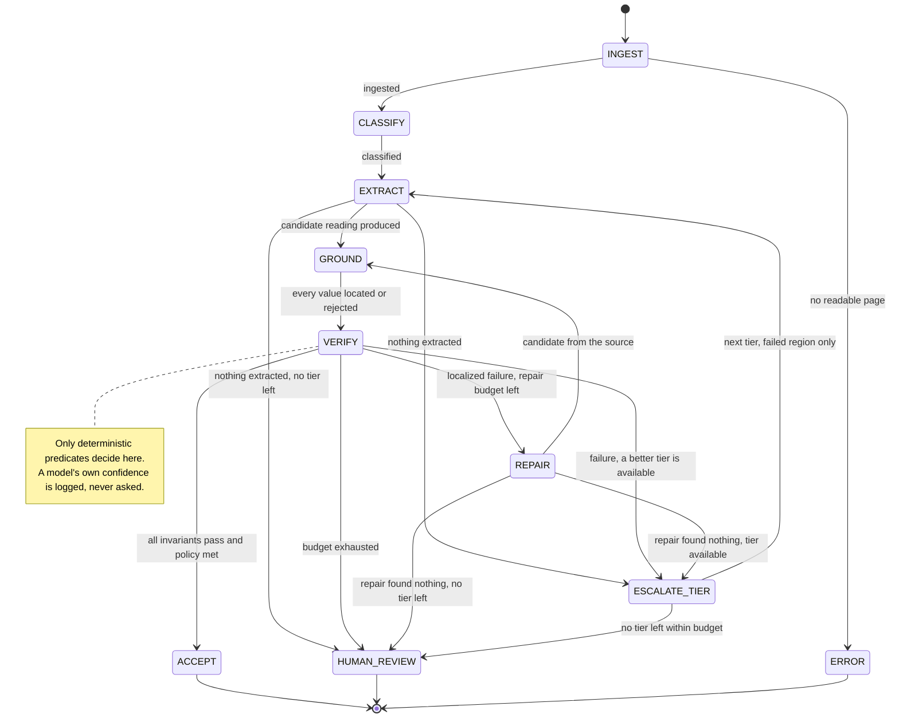

# The state machine

The machine is data, not control flow. States are an enum, transitions are an ordered
table, guards are named deterministic functions of the run state, and the loop that drives them is about twenty
lines in [`probity/machine.py`](../probity/machine.py) and
[`probity/pipeline.py`](../probity/pipeline.py).

The diagram below is generated from that table by
[`probity/export.py`](../probity/export.py). A test checks that every transition in the
table appears in this document; it does not check labels or ordering, so regenerate the
diagram with `probity machine --format mermaid` after changing the table.

Two guards are not pure predicates: `repairable` records which region it selected and
`tier_advanced` moves the reader pointer. Both are deterministic, and both write what
they did to the trace.



## Why the diagram is Mermaid

Mermaid renders inline in a GitHub README and themes itself for light and dark mode, so
the picture lives next to the code and needs no build step or committed image. The same
string is also accepted by **[Stately Sketch](https://sketch.stately.ai/)** — paste
[`docs/assets/state_machine.mmd`](assets/state_machine.mmd) into it and you get an
interactive, simulatable version of this machine with no account and no install.

That is the whole of what we took from Stately. The reasoning is in the next section.

## What we looked at, and what we use

[stately.ai](https://stately.ai/) is useful here in one specific way, and the wrong
choice in another.

| Thing | Verdict | Why |
|---|---|---|
| **Stately Sketch** (`sketch.stately.ai`) | **Used.** | Free, no account, and it accepts Mermaid `stateDiagram-v2` directly. One string serves as the README diagram *and* an interactive simulator. |
| **XState v6 JSON** | **Emitted, optional.** | The serialization format is documented, so [`export.py`](../probity/export.py) writes [`state_machine.xstate.json`](assets/state_machine.xstate.json) for richer guard rendering. Nothing in the runtime reads it back, and XState v6 is still beta, so it is a convenience and not a dependency. |
| **Stately Studio** (hosted editor) | **Not used.** | On the free tier every project is public. Machines that will describe client document pipelines do not belong there. |
| **XState as a runtime** | **Not used.** | It is TypeScript, and this is a Python pipeline. |
| **`@xstate/cli` / `statelyai` CLI** | **Not used.** | `@xstate/cli` has not been published since January 2024 and only does TypeScript codegen; the current `statelyai` CLI syncs with the hosted Studio and needs a paid plan. Neither renders a diagram locally. |
| **`python-statemachine`, `transitions`** | **Not used as a runtime.** Worth knowing about. | Both are good libraries. `python-statemachine` 3.2.2 is the stronger one: a declarative JSON format with a published schema, and Mermaid/DOT export with no Graphviz needed. |
| **SCXML** | **Not used.** | A 2015 W3C standard with a thin and partly abandoned Python ecosystem, and semantics far richer than wanted here: event queues, `<invoke>`, parallel regions, a datamodel with expression evaluation. That is the hidden control flow this design is avoiding. (Also: `python-statemachine` before 3.2.0 evaluated SCXML expressions with `eval`, CVE-2026-47103.) |

### Why not just use a library

Because what these libraries sell is exactly what this design refuses. `python-statemachine`
3.x is a full statechart engine with an SCXML processing model, event queues, compound and
parallel states, history states and `<invoke>`. `transitions` generates trigger methods
dynamically and resolves callbacks by string name. Both are perfectly good, and both would
make the replay story *harder* to prove rather than easier.

What this project needs is the opposite: a `(state, guard) -> state` table that a reviewer
can read in one sitting, that serialises trivially, and whose every decision point is a
named predicate whose answer and evidence are written to the trace. That is about a
hundred lines we own outright. Auditability and exact replay are product features here,
not developer conveniences, and a dependency that owns the loop would put them at one
remove.

If you ever want the extra renderers, the cheap route is to emit `python-statemachine`'s
declarative JSON from our table at docs time and let it format Mermaid, DOT, Markdown or
reStructuredText. That keeps it a documentation-time dependency and out of the execution
path entirely.

## The table

Order within a source state is priority order: the first guard that answers yes wins. Every
non-terminal state ends with an unconditional fallback, which `Machine.validate()` enforces,
so no document can get stuck. `validate()` also rejects an unregistered guard and any
unreachable state.

| from | guard | to | meaning |
|---|---|---|---|
| INGEST | `ingest_failed` | ERROR | the file could not be opened or has no pages |
| INGEST | _(fallback)_ | CLASSIFY | ingested |
| CLASSIFY | _(fallback)_ | EXTRACT | digital or scanned, document type, template id |
| EXTRACT | `extract_empty_and_tier_left` | ESCALATE_TIER | the tier produced no rows and a more expensive tier is available |
| EXTRACT | `extract_empty` | HUMAN_REVIEW | nothing extracted, no tier left |
| EXTRACT | _(fallback)_ | GROUND | candidate reading produced |
| GROUND | _(fallback)_ | VERIFY | ungrounded values are marked, never silently kept |
| VERIFY | `accepts` | ACCEPT | all invariants pass and policy met |
| VERIFY | `repairable` | REPAIR | localized failure, repair budget left |
| VERIFY | `tier_left` | ESCALATE_TIER | failure, a better tier is available |
| VERIFY | _(fallback)_ | HUMAN_REVIEW | budget exhausted |
| REPAIR | `repair_proposed` | GROUND | candidate from the source |
| REPAIR | `tier_left` | ESCALATE_TIER | repair found nothing, tier available |
| REPAIR | _(fallback)_ | HUMAN_REVIEW | repair found nothing, no tier left |
| ESCALATE_TIER | `tier_advanced` | EXTRACT | next tier, failed region only |
| ESCALATE_TIER | _(fallback)_ | HUMAN_REVIEW | no tier left within budget |

## The guards

Every guard returns a verdict **and the evidence for it**, and both go into the trace.
This is why a log line reads

```
  ask  repairable                   no <- the failure is document-wide, so there is no
                                         region to re-read (GLOBAL_BAL); repairing without
                                         a location is how a model is invited to invent
```

rather than `branch 3 not taken`.

| guard | answers |
|---|---|
| `ingest_failed` | the file could not be opened or contains no pages |
| `extract_empty_and_tier_left` | this tier produced no rows and a dearer tier is free |
| `extract_empty` | this tier produced no rows |
| `accepts` | every invariant passed **and** the acceptance policy is satisfied |
| `repairable` | the failure is localized **and** this region has repair budget left |
| `tier_left` | a more capable tier is available within budget |
| `repair_proposed` | the repair produced a *grounded* candidate from the source |
| `tier_advanced` | the tier pointer moved to a usable tier |

One guard is deliberately missing: there is no `confident_enough`. A model's self-reported
confidence is recorded in the trace and never consulted by a transition (principle P4).

## Replay

`Trace.replay_hash()` hashes the deterministic fields of every event, excluding timestamps
and latencies. Two runs of the same document with the same configuration and the same
cached model responses produce the same hash; when they do not, `diff_traces()` prints the
first event where they parted.
